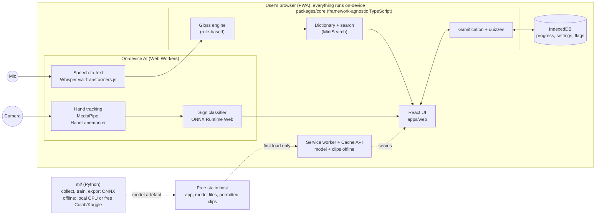

<div align="center">
  

# Tūtohu | Signify

_Speak it, sign it, learn it. NZSL translation and practice that never leaves your device._

  

Tūtohu | Signify is a web app (PWA) for **New Zealand Sign Language (NZSL)**. It turns spoken or typed English into a sequence of NZSL sign videos, recognises fingerspelling from your webcam and shows it as text, and wraps both in a learning experience with quizzes, streaks and milestones.

All speech recognition, hand tracking and sign classification run **in your browser, on your device**, using free open-source models. There is no server to pay for, no account to create and no audio or video upload. A browser-extension overlay (translate audio from other tabs) is planned after the MVP.
</div>

## Branch notes: `dev`

**Purpose**: Primary integration branch for active development. Features, fixes and refactors are merged here before being promoted to main.

**Notes**

- Keep builds passing (npm run lint and npm run test:examples).
- Merge tested work only.
- Sync regularly with main.
- May be unstable; do not demo from here.

> **Important:** The English → NZSL output is an _approximation_ built from dictionary signs and reordering rules. NZSL is a full natural language with its own grammar; this app is a learning and accessibility aid, **not a replacement for a qualified NZSL interpreter**.

---

## High-level MVP features (v0.1.0)

| # | Feature | Milestone |
|---|---|---|
| 1 | **Dictionary search and sign player.** Search English or te reo Māori words (macron-insensitive), replay at 0.5x/0.75x/1x, offline after first load. *(first feature)* | M1 |
| 2 | **Voice → sign.** Speak a phrase, edit the transcript, see it as a continuous sign sequence; unknown words are fingerspelled. | M2 |
| 3 | **Sign → text (fingerspelling).** Fingerspell to the webcam and see live text with confidence-smoothed letters. | M3 |
| 4 | **Learn and gamify.** XP, daily streaks, 5+ milestone badges, quizzes with spaced repetition, camera practice mode. | M4 |
| 5 | **Private by design.** Consent before mic/camera, no telemetry, no accounts, data export and one-click reset. | M5 |
| 6 | **Accessible.** WCAG 2.2 AA target, keyboard-first, reduced-motion and high-contrast modes. | M5 |
| 7 | **Installable and offline (PWA).** Works without a network after first load. | M5 |

---

## Architecture at a glance



Design rules that keep it simple and free:

1. **`packages/core` has no DOM or React.** All logic is plain TypeScript, so the same code can later power the browser extension or a mobile wrapper.
2. **Python is for training only.** Inference runs in the browser via ONNX, so there is no backend to host.
3. **Feature parity is tested.** Landmark normalisation exists in Python and TypeScript; a golden-fixture test keeps them identical so offline accuracy matches live behaviour.
4. **No runtime network except the app's own origin and an allow-listed model host.** A Playwright test enforces this.

More diagrams: [`docs/diagrams/class-diagram.drawio`](docs/diagrams/class-diagram.drawio) and [`docs/diagrams/sequence-diagrams.drawio`](docs/diagrams/sequence-diagrams.drawio) (open in [diagrams.net](https://app.diagrams.net)).

---

## Tech stack

| Layer | Choice | Licence / cost | Runs where |
|---|---|---|---|
| UI | React + TypeScript + Vite, Tailwind CSS | MIT | Browser |
| Monorepo | npm workspaces | MIT | Dev machine / CI |
| Dictionary search | MiniSearch | MIT | Browser |
| Hand tracking | MediaPipe Tasks Vision (HandLandmarker, WASM) | Apache-2.0 | Browser |
| Sign classifier | scikit-learn / PyTorch for training, ONNX Runtime Web for inference | BSD / BSD / MIT | Train: local or free Colab/Kaggle; infer: browser |
| Speech-to-text | Whisper (tiny/base) via Transformers.js, in a Web Worker | MIT code and weights | Browser (WebGPU, WASM fallback) |
| Optional STT mode | Browser Web Speech API (**opt-in only**, may send audio to the browser vendor) | Built in | Browser / vendor |
| Gloss engine | Rule-based TypeScript (+ `compromise` for tokenising) | MIT | Browser |
| Optional gloss assistant _(stretch)_ | Small open-weights model via WebLLM or localhost Ollama | Model licences vary, check each | Browser / localhost |
| Storage | IndexedDB (Dexie), Cache API | MIT | Browser |
| PWA | Workbox service worker | MIT | Browser |
| Tests | Vitest, Playwright, axe-core, pytest | MIT / Apache / MPL | CI |
| CI/CD | GitHub Actions | Free for public repos | GitHub |
| Hosting | GitHub Pages (or Cloudflare Pages) | Free tier | Static CDN |

**Cost-free AI, in practice:** no API keys, no per-call fees, no GPU server. Training uses your own CPU (the baseline trains in seconds) or free notebook GPUs. Free-tier limits change, so re-check hosting limits before each release (tracked in story S9.2).

**Data licence caveat (read this).** The NZSL dictionary videos and images belong to the Deaf Studies Research Unit (DSRU), Victoria University of Wellington. The community dataset is CC BY-NC-SA 3.0, and the official site permits personal and teaching use but requires permission for commercial use or for remixing/adapting content. Therefore:

- The repo **does not contain clips**; `pnpm data:fetch` downloads them locally.
- A public hosted build must not ship clips until written permission is obtained (story S8.4).
- Stitching clips into sentences is arguably "remixing", which is one more reason to ask first.

---

## Installation and setup

### Prerequisites

- **Node.js** 22 LTS (20+ works) and **pnpm** 9+
- **Git**
- A modern browser: Chrome/Edge/Firefox/Safari, recent versions. WebGPU is optional; without it speech recognition falls back to slower WASM.
- A **webcam and microphone** for the camera and voice features
- **Disk space:** a few hundred MB for the curated sign subset plus model files (exact numbers will be documented when S2.1 lands)
- _Only for the `ml/` tooling:_ **Python 3.11+**; _optional_ **FFmpeg** for clip re-encoding during data prep

### Steps

```bash
# 1. Clone
git clone https://github.com/arzen1kos/nzsl-app.git
cd nzsl-app

# 2. Install JS dependencies                       (planned: Sprint 1, S1.1)
npm install

# 3. Fetch the curated NZSL subset into data/      (planned: S2.1)
#    Read data/ATTRIBUTION.md first: CC BY-NC-SA 3.0 + DSRU terms apply.
npm data:fetch

# 4. Build the searchable dictionary index         (planned: S2.2)
npm data:index

# 5. Run the app
npm dev            # http://localhost:5173

# 6. Checks
npm lint && npm typecheck && npm test
npm test:e2e       # Playwright: offline mode, network allow-list, a11y
```

**Training your own fingerspelling model (works today with the baseline in `ml/`):**

```bash
cd ml
python -m venv .venv && source .venv/bin/activate   # Windows: .venv\Scripts\activate
pip install -r requirements.txt
python collect_data.py --labels A B C D E           # hold a key to record; landmarks only, no video
python train.py                                     # prints per-class report, saves models/*.joblib
python infer_live.py                                # desktop webcam demo
# python export_onnx.py                             # planned: S6.4 (browser model)
```

Only record people who have given informed consent. See [`docs/ai-ml/data-card.md`](docs/ai-ml/data-card.md).

### What's in the repo

| Path | State |
|---|---|
| `ml/` baseline (`landmarks.py`, `collect_data.py`, `train.py`, `infer_live.py`) | Exists (syntax-checked; run on your machine to confirm) |
| `docs/` backlog, diagrams, security, AI/ML documents, pipeline | Exists |
| `.github/workflows/` CI + deploy | Exists (templates; will run once the scaffold lands) |
| `apps/web`, `packages/core` | Planned: Sprint 1 |
| `apps/extension` | Planned: post-MVP (M7) |

### Planned layout

```text
nzsl-app/
├── apps/web/           # React PWA (Vite)
├── apps/extension/     # MV3 shell (post-MVP)
├── packages/core/      # framework-agnostic TS: gloss, dictionary, gamification, recognition interfaces
├── ml/                 # Python: collect, train, evaluate, export ONNX
├── data/               # gitignored: downloaded clips + generated index; ATTRIBUTION.md committed
├── scripts/            # data:fetch, data:index
├── docs/               # backlog, diagrams, security, ai-ml, pipeline, ADRs
└── .github/workflows/
```

---

## Documentation

| Topic | Location |
|---|---|
| Security and compliance (wiki page) | [`docs/security/SECURITY-COMPLIANCE.md`](docs/security/SECURITY-COMPLIANCE.md) |
| Privacy notice (draft) | [`docs/security/privacy-notice.md`](docs/security/privacy-notice.md) |
| Vulnerability reporting | [`SECURITY.md`](SECURITY.md) |
| Model card, data card, evaluation plan | [`docs/ai-ml/`](docs/ai-ml/) |
| Gloss engine design | [`docs/ai-ml/gloss-engine-design.md`](docs/ai-ml/gloss-engine-design.md) |
| Portfolio case study | [`docs/ai-ml/portfolio-case-study.md`](docs/ai-ml/portfolio-case-study.md) |
| UML class and sequence diagrams | [`docs/diagrams/`](docs/diagrams/) |

## Security and privacy

Microphone and camera data are processed in memory on your device and are never uploaded or stored. Progress lives in your browser's IndexedDB and can be exported or erased in one click. There are no accounts, no analytics and no third-party scripts. The only network traffic after install is to the app's own origin (and, on first load, an allow-listed model host). Details and the NZ Privacy Act 2020 mapping are in [`docs/security/SECURITY-COMPLIANCE.md`](docs/security/SECURITY-COMPLIANCE.md). This is engineering documentation, not legal advice.

## Licence and attribution

- **Code:** choose and add a licence file (MIT is a good fit for the code).
- **NZSL dictionary data (videos, images, glosses):** © Deaf Studies Research Unit, Victoria University of Wellington. Cite as: McKee, D., McKee, R., Pivac Alexander, S., Pivac, L., & Vale, M. (2011). _Online dictionary of New Zealand Sign Language_. https://www.nzsl.nz. Community dataset: [Bluebie/NZSL-Dictionary](https://github.com/bluebie/nzsl-dictionary) (CC BY-NC-SA 3.0). Not redistributed from this repository.
- **Third-party libraries:** see the generated licence report (story S8.4).

## Acknowledgements

NZSL is an official language of Aotearoa New Zealand. Thanks to the DSRU and the Deaf community whose work makes resources like the NZSL dictionary possible. Community review of this project is tracked in story S8.5.

---

Created by Arsenie — 2026
